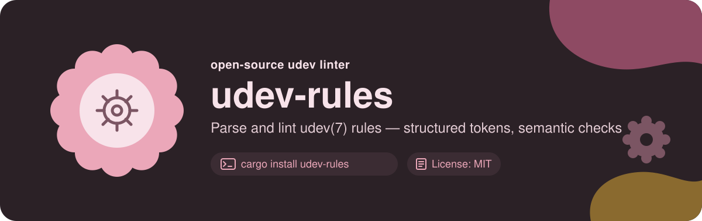
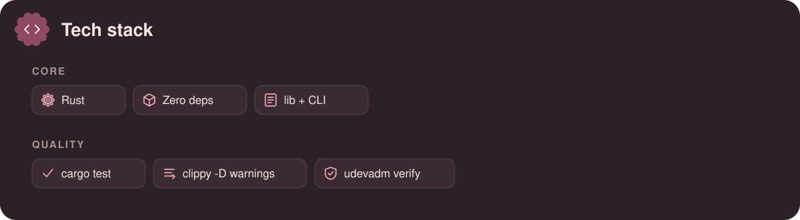

<p align="center">
  
</p>
<p align="center">
  <a href="https://github.com/Celine1337/udev-rules/releases"></a>
  <a href="https://man7.org/linux/man-pages/man7/udev.7.html"></a>
  <a href="LICENSE"></a>
</p>


**udev-rules** is a Rust parser and semantic linter for **`udev(7)` rules files**. It turns each rule into structured tokens (`key`, `{subkey}`, operator, value) and then checks meaning: operator/key compatibility, `GOTO`/`LABEL` resolution, required `{name}` subkeys, octal `MODE`, empty `RUN`, unknown `OPTIONS`, and naming on `remove` events. `udevadm verify` checks syntax; this crate gives you the parse tree *and* the semantic layer, as a library and a CLI, with zero dependencies.

What it is **not**: a udev daemon or a rule installer. It never touches `/etc/udev` or triggers events — it reads rules files and tells you what is wrong before you deploy them.


- **Real grammar** — comma-separated tokens, all six operators (`== != = += -= :=`), `{subkey}` keys, double-quoted values with escapes, `#` comments, and backslash line continuation.
- **Structured parse tree** — `parse()` returns rules and tokens as data you can inspect, transform, or serialize (`parse --json`).
- **Semantic lint** — unknown keys, match-only vs assign-only operator misuse, missing required subkeys, dangling `GOTO`, duplicate `LABEL`, non-octal `MODE`, empty `RUN`/`PROGRAM`/`IMPORT`, unknown `OPTIONS`, `NAME`/`SYMLINK` on `ACTION=="remove"`.
- **Style warnings** — stray commas are reported as warnings, mirroring `udevadm verify`'s style pass (`--no-style` equivalent is `-q`).
- **Cross-validated** — the test suite asserts zero errors across every rules file shipped by the host's udev, and agrees with `udevadm verify --no-style`.
- **Zero dependencies** — pure Rust, edition 2021.




As a library:

```toml
[dependencies]
udev-rules = { git = "https://github.com/Celine1337/udev-rules" }
```

As a CLI:

```bash
cargo install --git https://github.com/Celine1337/udev-rules
```

Or from a checkout:

```bash
git clone https://github.com/Celine1337/udev-rules.git
cd udev-rules
cargo build --release
```


CLI:

```bash
udev-rules lint /etc/udev/rules.d/99-my.rules
udev-rules lint --strict --json /etc/udev/rules.d/*.rules
udev-rules parse --json 99-my.rules
```

```text
99-my.rules:3:1: error: [U004] GOTO target 'end' is not defined by any LABEL
99-my.rules:5:1: warning: [U006] MODE '0999' is not an octal permission
99-my.rules: 1 error(s), 1 warning(s)
```

Library:

```rust
use udev_rules::{check, parse};

let diags = check(r#"SUBSYSTEM=="net", ACTION=="add", NAME="eth0""#);
assert!(diags.is_empty());

let tree = parse(r#"ENV{ID_FS_USAGE}=="filesystem", MODE="0660""#);
assert_eq!(tree.rules[0].tokens[0].subkey.as_deref(), Some("ID_FS_USAGE"));
```

Selected rules:

| Code | Severity | Meaning |
| --- | --- | --- |
| U001 | error | unknown key |
| U002 | error | operator not allowed for this key (match-only vs assign-only) |
| U003 | error | key requires a `{name}` subkey |
| U004 / U005 | error | `GOTO` to undefined label / duplicate `LABEL` |
| U006 | warning | `MODE` is not octal |
| U009 | warning | `NAME`/`SYMLINK` assigned on `ACTION=="remove"` |
| U102 | warning | stray comma (style, matches `udevadm verify`) |

Run the tests (the oracle test skips gracefully when udev is absent):

```bash
cargo test
```

Known boundaries, stated plainly:

- Value substitutions (`$env{…}`, `%k`, …) are kept as opaque strings; they are not expanded or validated.
- The key/operator table covers the keys in `udev(7)`; exotic or vendor keys are reported as `U001` rather than silently accepted.
- `TEST` and `RUN` subkeys are optional, matching udev; `ENV`, `ATTR`, `ATTRS`, `IMPORT`, `CONST` require one.


MIT © 2026 Celine1337 — see [LICENSE](LICENSE).